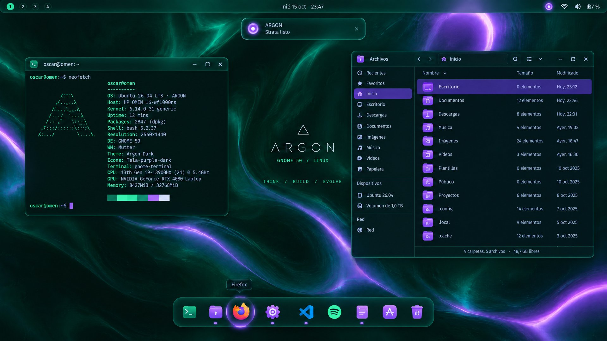
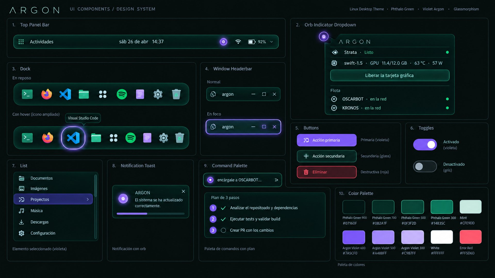

<h1 align="center">ARGON OS</h1>

<p align="center"><b>Ubuntu con alma de vidrio: verde phthalo, brillo de argón y un asistente local en el panel.</b><br>
Se instala encima de Ubuntu 24.04+ con GNOME, paso a paso, y se deshace con un comando.</p>

<p align="center"><br>
<sub>Mockup de diseño que guía el proyecto (generado con IA). Las capturas reales vienen pronto.</sub></p>

*English: ARGON OS is a GNOME customization layer for Ubuntu (glass panels in phthalo green, argon-violet accents,
animated wallpaper, custom boot and login screens) plus an optional local AI desktop assistant. One-line, step-by-step
installer; fully reversible. Docs are in Spanish for now.*

## Instalar

```bash
curl -fsSL https://raw.githubusercontent.com/windsurfgitano-cmd/ARGONOS/main/install.sh | bash
```

El instalador te muestra cada componente, tú marcas lo que quieres y te cuenta qué hace en cada paso.
Antes de tocar nada guarda un respaldo de tu configuración.

```text
[3/7] Tema ARGON
──────────────────────────────────────────────────────────────
  ✓ Bajando Marble (tema del panel y menús)
  ✓ Generando Marble-argon (violeta, tono 258)
  ✓ Capa de vidrio verde aplicada
  ✓ Modo oscuro, acento violeta y apps GTK 4 con la paleta ARGON
```

O desde una copia del repo:

```bash
git clone https://github.com/windsurfgitano-cmd/ARGONOS.git
cd ARGONOS
./install.sh
```

| Opción | Qué hace |
|---|---|
| `./install.sh` | Menú paso a paso |
| `./install.sh --si` | Instala lo recomendado sin preguntar |
| `./install.sh --solo tema,iconos` | Solo esos componentes |
| `./install.sh --lista` | Lista los componentes |
| `./install.sh --desinstalar` | Vuelve a como venía Ubuntu |

## Qué trae

| Componente | Detalle | Por defecto |
|---|---|---|
| **Tema ARGON** | [Marble](https://github.com/imarkoff/Marble-shell-theme) en violeta + capa de vidrio verde para menús, avisos y diálogos; modo oscuro; apps GTK 4 / libadwaita con la paleta ARGON | ✓ |
| **Íconos** | [Colloid](https://github.com/vinceliuice/Colloid-icon-theme) violeta oscuro | ✓ |
| **Dock y efectos** | Dock de vidrio con animaciones, desenfoque en panel, cubo 3D de escritorios, Alt+Tab 3D, ventanas gelatina, efectos al abrir y cerrar, círculos numerados de escritorios | ✓ |
| **Fondo** | Fondo ARGON en escritorio y bloqueo | ✓ |
| **Terminal** | Paleta ARGON para Ptyxis con transparencia | ✓ |
| **Fondo animado** | Video en bucle con [Hanabi](https://github.com/jeffshee/gnome-ext-hanabi); se pausa con batería o con una ventana maximizada | opcional |
| **Arranque y login** | Orbe de plasma animado al encender (Plymouth), pantalla de inicio de sesión ARGON y nombre "ARGON OS" | opcional |
| **Asistente ARGON** | Orbe en el panel, ventana ARGON con `Super + Espacio`, historial e hilos, permisos con botones | experimental |
| **Voz** | Hablarle al asistente (Whisper) y que te conteste (Piper), todo en tu equipo | experimental |

<p align="center"></p>

### Regla de color

**Superficies en verde phthalo, interacción en violeta argón.** El sistema de diseño completo (paleta medida,
componentes y medidas) está en [`argon/diseno/DISENO.md`](argon/diseno/DISENO.md).

## El asistente

`Super + Espacio` abre la ventana ARGON. Le pides algo en español, por texto o por voz, y un agente lo hace en tu
equipo mostrando cada comando en vivo. Lo delicado te pide permiso con botones antes de ejecutarse.

- **argond**: servicio de usuario (systemd) con API solo en `127.0.0.1`, clave local con permisos 600 e historial en SQLite.
- **Modelo local**: habla con [Strata](https://github.com/Niko1221/Strata) en `127.0.0.1:8080` (un modelo grande en tu GPU).
- **Agente**: usa [Hermes](https://github.com/NousResearch/hermes-agent) por ACP; las herramientas de escritorio (abrir apps, carpetas, escritorios, modo foco) van por MCP.
- **Flota (opcional)**: si tienes otros equipos en Tailscale, el orbe muestra si están en línea y ARGON puede mandarles encargos que tú confirmas. Se configura en `~/.config/argon/argon.json` (ejemplo en [`config/argon.flota-ejemplo.json`](config/argon.flota-ejemplo.json)).

Sin Strata ni Hermes la parte visual funciona igual; el asistente es la capa experimental.

## Estructura

```text
install.sh            instalador paso a paso (también funciona con curl | bash)
config/               ajustes que aplica el instalador (extensiones, GTK 4, capa del tema, terminal)
argon/
  orbe/               extensión de GNOME: orbe en el panel y Super + Espacio
  app/                ventana ARGON (GTK 4 + libadwaita)
  argond/             servicio del asistente y servidor MCP
  voz/                servicio de voz
  plymouth-argon/     pantalla de arranque
  login-argon/        logo del login
  herramientas/       generadores de marca, fondos, orbe animado y tema del login
  instalar/           scripts de sistema (arranque, login, revertir)
  marca/ fondos/ diseno/ bocetos/
```

## Probado en

HP OMEN 16 · Ubuntu 26.04.1 LTS · GNOME 50.1 · Wayland · 2560×1440 @ 240 Hz · Intel + RTX 4080.
En GNOME 46–49 lo visual debería funcionar; si algo no calza, [abre un issue](https://github.com/windsurfgitano-cmd/ARGONOS/issues).

## Hoja de ruta

- [x] Identidad visual, tema, íconos, dock y efectos
- [x] Arranque y login ARGON
- [x] Asistente con historial, permisos, actividad en vivo y voz
- [x] Instalador paso a paso y reversible
- [ ] Capturas y video reales
- [ ] ISO instalable de ARGON OS (Ubuntu con todo esto de fábrica)
- [ ] Cada escritorio del cubo como un proyecto ("¿dónde quedé?")

## Créditos y licencia

ARGON OS es GPL-3.0. Se apoya en el trabajo de
[Marble](https://github.com/imarkoff/Marble-shell-theme),
[Colloid](https://github.com/vinceliuice/Colloid-icon-theme),
[Hanabi](https://github.com/jeffshee/gnome-ext-hanabi),
[Blur my Shell](https://github.com/aunetx/blur-my-shell),
[Dash2Dock Animated](https://github.com/icedman/dash2dock-lite),
[Desktop Cube y Burn My Windows](https://github.com/Schneegans),
[Coverflow Alt-Tab](https://github.com/dsheeler/CoverflowAltTab),
[Compiz windows effect](https://github.com/hermes83/compiz-windows-effect) y
[Space Bar](https://github.com/christopher-l/space-bar). El instalador los baja de sus fuentes originales.

Hecho en Chile por [@windsurfgitano-cmd](https://github.com/windsurfgitano-cmd).
